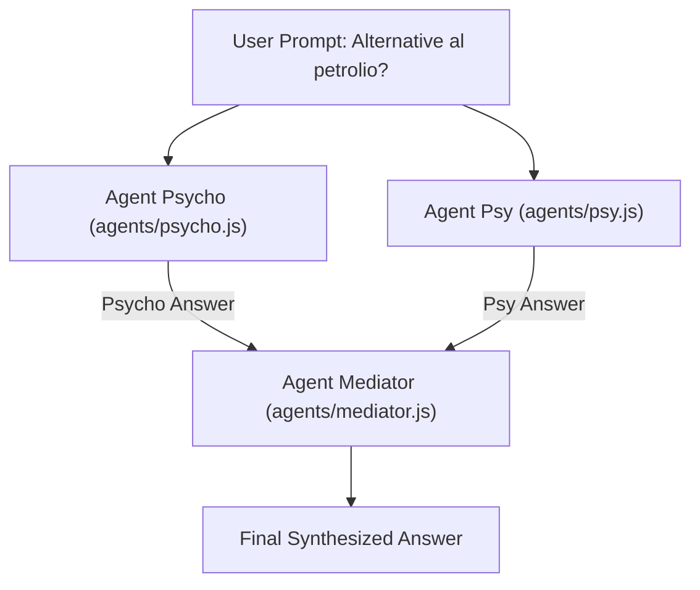

# 🦜️🔗 LangChain.js - From Basics to Multi-Agent Systems & Express APIs

An educational, practical project built with **Node.js** and **LangChain.js**. It demonstrates the progression from foundational LLM calls to conversational memory, custom tool integration, structured responses with Zod schemas, modular multi-agent collaboration, and serving agents over an **Express.js REST API**.

---

## 📖 Table of Contents

1. [What is LangChain?](#-what-is-langchain)
2. [Core LangChain Concepts in This Project](#-core-langchain-concepts-in-this-project)
   - [1. Model Abstraction & Centralized Configuration](#1-model-abstraction--centralized-configuration)
   - [2. Typed Messages System (`HumanMessage` & `AIMessage`)](#2-typed-messages-system-humanmessage--aimessage)
   - [3. Stateless Calls vs. Conversational Memory](#3-stateless-calls-vs-conversational-memory)
   - [4. Custom Tools & Schema Validation with Zod](#4-custom-tools--schema-validation-with-zod)
   - [5. Structured Output Extraction (`responseFormat`)](#5-structured-output-extraction-responseformat)
   - [6. Modular Multi-Agent Collaboration](#6-modular-multi-agent-collaboration)
   - [7. Express.js REST API Integration](#7-expressjs-rest-api-integration)
3. [Project Directory Structure](#-project-directory-structure)
4. [File Overview](#-file-overview)
5. [REST API Endpoints Reference](#-rest-api-endpoints-reference)
6. [Prerequisites & Setup](#-prerequisites--setup)
7. [Running the Application & Scripts](#-running-the-application--scripts)
8. [Key Dependencies](#-key-dependencies)

---

## 🧠 What is LangChain?

**LangChain** is an open-source framework designed to simplify building applications powered by Large Language Models (LLMs).

Interacting with LLMs purely through raw HTTP API calls introduces significant complexity:
- Managing vendor-specific JSON payloads across different providers (Anthropic, OpenRouter, Mistral).
- Handling Function Calling / Tool Calling low-level schemas and responses.
- Enforcing structured output and JSON validation.
- Orchestrating multi-turn memory and multi-agent interaction loops.

**LangChain solves these challenges by providing:**
- **Unified Interface**: Use the same `.invoke()` syntax across dozens of LLM providers.
- **Typed Message Objects**: Clean classes like `HumanMessage`, `AIMessage`, and `SystemMessage`.
- **Tool Calling & Zod Validation**: Expose JavaScript functions as tools with typed argument schemas.
- **Structured Response Formats**: Enforce strictly typed JSON responses from the model.
- **Autonomous & Collaborative Agents**: Build single-purpose or multi-agent pipelines where agents reason, use tools, and deliberate together.

---

## 🧩 Core LangChain Concepts in This Project

### 1. Model Abstraction & Centralized Configuration
LangChain abstracts LLM providers behind unified classes. In [`models/openrouter.js`](models/openrouter.js), an OpenRouter model instance is configured centrally and exported for reuse across agents:

```javascript
import { ChatOpenRouter } from "@langchain/openrouter";
import 'dotenv/config';

const openRouterModel = new ChatOpenRouter({
    model: 'nvidia/nemotron-3-ultra-550b-a55b:free',
    apiKey: process.env.OPENROUTER_API_KEY
});

export default openRouterModel;
```

---

### 2. Typed Messages System (`HumanMessage` & `AIMessage`)
Interactions in LangChain are represented as typed message objects rather than simple strings:
- `HumanMessage`: Represents user input.
- `AIMessage`: Represents model output (`response.content` or `response.structuredResponse`).
- `SystemMessage`: Sets personality, boundaries, or instructions.

```javascript
import { HumanMessage } from 'langchain';

const response = await model.invoke([
    new HumanMessage('Hello! Explain what LangChain is in one sentence.')
]);
console.log(response.content);
```

---

### 3. Stateless Calls vs. Conversational Memory
LLM APIs are fundamentally **stateless**: each request is independent and the model retains no internal memory.

- **Stateless ([`stateless.js`](stateless.js))**: Making two separate calls means the second call has no knowledge of the first.
- **History Management ([`history-chat.js`](history-chat.js))**: Maintaining a `messages = []` array and pushing each `HumanMessage` and returned `AIMessage` ensures the model receives full context on every turn.

---

### 4. Custom Tools & Schema Validation with Zod
When an LLM needs external or dynamic data (e.g., weather, database records), LangChain **Tools** bridge the gap.

In [`tools/weatherTool.js`](tools/weatherTool.js):
- `tool()` wraps a JavaScript function into an LLM-callable tool.
- **Zod** (`z.object({...})`) defines and validates input schemas with descriptions that the model inspects to decide when to invoke the tool:

```javascript
import { tool } from 'langchain';
import { z } from 'zod';

const getWeatherSchema = z.object({
    city: z.string().describe('The city to look up weather for.')
});

const getWeather = tool(getWeatherFunction, {
    name: 'get_weather',
    description: 'Returns current weather for an Italian city.',
    schema: getWeatherSchema
});
```

In [`agent-weather.js`](agent-weather.js), `createAgent({ model, tools: [getWeather] })` automatically decides to invoke the tool when the user asks a question about the weather.

---

### 5. Structured Output Extraction (`responseFormat`)
In [`review.js`](review.js), LangChain enforces a strict output schema using **Zod** via the `responseFormat` option in `createAgent`:

```javascript
const agent = createAgent({
    model,
    tools: [getWeather],
    systemPrompt: `Sei un analizzatore di recensioni online di un ristorante`,
    responseFormat: z.object({
        sentiment: z.enum(['positiva', 'negativa']),
        score: z.number().min(1).max(5),
        feedback: z.string()
    })
});

const result = await agent.invoke({ messages: [...] });
// Directly access the parsed and validated object:
console.log(result.structuredResponse);
// Output: { sentiment: 'positiva', score: 5, feedback: '...' }
```

---

### 6. Modular Multi-Agent Collaboration
In the [`agents/`](agents/) directory, specialized agents are split into separate modules:
- [`agents/psycho.js`](agents/psycho.js): An unconventional agent programmed to suggest creative bugs and controversial ideas.
- [`agents/psy.js`](agents/psy.js): An agent acting as a psychoanalyst interpreting topics through Jungian and Freudian lenses.
- [`agents/mediator.js`](agents/mediator.js): A mediating agent tasked with reconciling opposing viewpoints.
- [`agents/generic.js`](agents/generic.js): A lightweight, general-purpose assistant.

In [`multiagent.js`](multiagent.js), the agents interact in a collaborative workflow:


---

### 7. Express.js REST API Integration
LangChain agents can easily power HTTP APIs. This project wraps an agent within an **Express.js** web server:
- [`server.js`](server.js): Starts the Express application on `process.env.PORT` (defaults to 3000) and mounts `/ai`.
- [`routers/aiRouter.js`](routers/aiRouter.js): Exposes GET and POST endpoints calling `genericAgent`.

---

## 📂 Project Directory Structure

```plaintext
langchain/
├── agents/
│   ├── generic.js          # Generic LangChain agent instance
│   ├── mediator.js         # Mediator agent reconciling different views
│   ├── psy.js              # Jungian / Freudian psychiatrist persona
│   └── psycho.js           # Eccentric persona focusing on coding bugs
├── data/
│   └── db.js               # Mock database array of tech products
├── models/
│   └── openrouter.js       # Centralized ChatOpenRouter model configuration
├── routers/
│   └── aiRouter.js         # Express routes (/ai and /ai/chat)
├── tools/
│   └── weatherTool.js      # Custom mock weather tool defined with Zod
├── .env                    # Local environment variables & API keys
├── .env.example            # Example environment file template
├── agent-weather.js        # Autonomous agent using the weather tool
├── history-chat.js         # Multi-turn conversation preserving message history
├── main.js                 # Foundational LangChain invoke example
├── multiagent.js           # Multi-agent debate and mediation pipeline
├── no-tool.js              # Demonstrates LLM limitations without tools
├── review.js               # Structured output extraction (sentiment & score)
├── server.js               # Express server entry point
├── stateless.js            # Demonstrates the stateless nature of LLMs
└── package.json            # Project dependencies and npm/pnpm scripts
```

---

## 📋 File Overview

| File | Type | Description |
|---|---|---|
| [`server.js`](server.js) | Server | Express HTTP server setup on `PORT` mounting `/ai` routes |
| [`routers/aiRouter.js`](routers/aiRouter.js) | Router | Express router providing `GET /ai` and `POST /ai/chat` |
| [`models/openrouter.js`](models/openrouter.js) | Config | Shared `ChatOpenRouter` instance configured from `.env` |
| [`agents/generic.js`](agents/generic.js) | Agent | General-purpose agent using `openRouterModel` |
| [`agents/psycho.js`](agents/psycho.js) | Agent | Persona agent suggesting unorthodox coding bugs |
| [`agents/psy.js`](agents/psy.js) | Agent | Persona agent analyzing questions through psychoanalysis |
| [`agents/mediator.js`](agents/mediator.js) | Agent | Persona agent synthesizing and resolving conflicting agent outputs |
| [`multiagent.js`](multiagent.js) | Pipeline | Orchestrates Psycho & Psy debating, mediated by Mediator |
| [`review.js`](review.js) | Agent | Reviews analyzer enforcing structured Zod output (`sentiment`, `score`) |
| [`data/db.js`](data/db.js) | Data | Mock dataset of tech accessories (mouse, keyboard, monitors, etc.) |
| [`tools/weatherTool.js`](tools/weatherTool.js) | Tool | Tool definition using `tool()` and Zod schema parameter validation |
| [`agent-weather.js`](agent-weather.js) | Script | Agent with autonomous tool calling for weather queries |
| [`history-chat.js`](history-chat.js) | Script | Multi-turn chat maintaining conversation state in an array |
| [`stateless.js`](stateless.js) | Script | Shows lack of memory across isolated model invocations |
| [`no-tool.js`](no-tool.js) | Script | Demonstrates LLM real-time data limitations without tools |
| [`main.js`](main.js) | Script | Minimal prompt call using `ChatOpenRouter` and `HumanMessage` |

---

## 🌐 REST API Endpoints Reference

When the Express server is running, the following endpoints are available:

### 1. `GET /ai`
Send a quick query via URL query parameters.

- **URL**: `http://localhost:3000/ai?request=Ciao`
- **Method**: `GET`
- **Response**:
  ```text
  Stai chiedendo: Ciao
  ```

---

### 2. `POST /ai/chat`
Send a user prompt in JSON format and receive an AI-generated textual response (instructed to omit Markdown).

- **URL**: `http://localhost:3000/ai/chat`
- **Method**: `POST`
- **Headers**: `Content-Type: application/json`
- **Request Body**:
  ```json
  {
    "message": "Spiegami brevemente cos'è una REST API"
  }
  ```
- **Response**:
  ```json
  {
    "risposta": "Una REST API è un'interfaccia che consente a due sistemi informatici di comunicare tra loro su rete attraverso il protocollo HTTP..."
  }
  ```

---

## ⚙️ Prerequisites & Setup

### 1. Prerequisites
- **Node.js** (v18 or higher recommended)
- **pnpm** (or npm / yarn)

### 2. Install Dependencies
```bash
pnpm install
```

### 3. Environment Variables Configuration
Copy `.env.example` to create your local `.env`:

```bash
cp .env.example .env
```

Ensure `.env` contains your API key and server port:

```env
ANTHROPIC_API_KEY=your_anthropic_api_key_here
MISTRAL_VIBE_API_KEY=your_mistral_vibe_api_key_here
OPENROUTER_API_KEY=your_openrouter_api_key_here

PORT=3000
```

---

## 🚀 Running the Application & Scripts

### Run the Express Web Server
```bash
# Development mode with hot-reloading (Node --watch)
pnpm run dev

# Production start
pnpm run start
```

### Run Standalone LangChain Scripts

```bash
# Multi-agent debate & mediation
node multiagent.js

# Review analyzer with structured Zod output
node review.js

# Weather agent with autonomous tool calling
node agent-weather.js

# Conversational memory with history array
node history-chat.js

# Stateless behavior demonstration
node stateless.js

# Foundational single prompt execution
node main.js
```

---

## 📦 Key Dependencies

- **`langchain`**: Core primitives (`HumanMessage`, `AIMessage`), agent orchestrator (`createAgent`), and tool constructor (`tool`).
- **`@langchain/openrouter`**: Provider adapter for OpenRouter models.
- **`@langchain/anthropic`**: Official adapter for Anthropic Claude models.
- **`@langchain/mistralai`**: Official adapter for Mistral AI models.
- **`express`**: Fast, minimalist web framework powering the REST API.
- **`zod`**: Schema validation library used for Tool input schemas and structured agent outputs (`responseFormat`).
- **`dotenv`**: Loads environment variables from `.env` into `process.env`.
